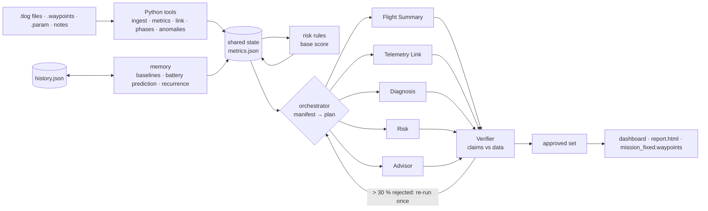

# AeroMind

Post-flight analysis for ArduPilot drones by a team of AI agents. Drop in a flight's files and get
one page that says how the flight went, how the telemetry link held up the whole time, what went
wrong and why, how risky the next mission is, and a corrected mission file to fly next.

Every number comes from Python tools that read the logs; the agents only see those computed
metrics, a Verifier rejects any claim the data does not support, and nothing is ever written to
the drone. Results on the demo flights: [docs/RESULTS.md](docs/RESULTS.md). Design and build plan:
[docs/PLAN.md](docs/PLAN.md); product requirements: [docs/AeroMind — Final PRD.pdf](docs/AeroMind%20—%20Final%20PRD.pdf).

## Results on the demo flights

Eight SITL flights (S0–S4 and re-flights of S1, S2, S4 with the fixed missions), agents on a local
`qwen2.5:3b`. Full table: [docs/RESULTS.md](docs/RESULTS.md).

- **Pass (8 of 10):** fault detection 4/4, root cause 4/4, both S3 dropouts located within 0.1 s,
  no false alarms on S0, S2's fixed mission landed with 25 % (was 14 %), battery predictions within
  7 points, risk S0 Low / S2 High / S4 High.
- **Tracking improvement: fail (20 %, target 40 %).** S1's original cross-track was only 1.8 m
  (Caution): in a 10 m/s crosswind the Hexa-X reaches its 30° tilt limit at about 9.5 m/s, so it never
  flew the 12 m/s that would have driven it off track. Slowing to 6 m/s cut it to 1.44 m.
- **Speed: fail with the local model (median 92 s, target 60 s).** The metrics take about 2 s; the
  rest is six calls to a 3B model on a 4 GB laptop GPU (30–65 s in an earlier run). Claude via the API
  is expected to be well inside the target but has not been measured here.
- **Grounding:** the Verifier rejected 29 % of the small model's claims; each was replaced by the
  rule-based result, so nothing unverified reached the dashboard.

## Run it

```bash
pip install -e .                       # pymavlink pandas numpy plotly streamlit jinja2 python-dotenv pydantic anthropic
python3 run.py --batch data/           # analyse the demo flights (fills history.json and outputs/)
streamlit run app.py                   # dashboard on http://localhost:8501
```

One flight, several logs allowed (a reconnect splits a flight into several .tlog files):

```bash
python3 run.py --tlog data/s1/*.tlog --mission data/s1/mission.waypoints --params data/s1/params.param \
               --notes "drifted on leg 3"
python3 run.py --compare outputs/s1 outputs/s1_fixed     # before/after table
python3 run.py --results                                  # success metrics -> docs/RESULTS.md
```

**LLM.** Copy `.env.example` to `.env`. With `ANTHROPIC_API_KEY` set the agents use Claude
(`claude-opus-5-5`); without it they use a local [Ollama](https://ollama.com) model
(`qwen2.5:3b` by default, `ollama pull qwen2.5:3b`); with neither, or `--llm none`, every agent
uses its rule-based version. Saved runs replay from `outputs/<run>/state.json`, so the dashboard
works offline.

## What it produces

| Output | What |
|---|---|
| `outputs/<run>/state.json` | every metric, the orchestrator's plan, each agent's output and source, the Verifier's verdicts |
| `outputs/<run>/report.html` | the analysis as one printable page |
| `outputs/<run>/mission_fixed.waypoints` | the mission with the approved edits (QGC WPL 110, loads in Mission Planner / QGroundControl) |
| `outputs/<run>/changelog.md` | which edits were applied or rejected, and why |
| `history.json` | one record per analysed flight: baselines, battery prediction, recurring issues, what worked |

## How it works



- **Tools (no LLM)** turn the logs into one set of metrics with Good / Caution / Bad statuses and a
  health score: flight, battery, cross-track per leg, vibration, GPS, wind, attitude, warnings and
  failsafes, and the telemetry link across the whole flight (dropouts with time, duration, position
  and nearest waypoint; packet loss from MAVLink sequence numbers; RSSI when a radio reports it).
- **Orchestrator** builds a manifest of what exists and what looks wrong, asks the LLM for a plan,
  checks it against the rules (summary first, verifier last, diagnosis only when something is wrong)
  and runs the agents on a shared state.
- **Agents** are one prompt and one JSON schema each. Python keeps what must be exact: the risk score
  is the rule score plus at most ±10, the link verdict follows the statuses, and mission edits pass
  hard limits (speed 3–10 m/s, altitude 25–120 m, at most 30 % of waypoints removed, never the
  take-off or RTL, clear of the radio mast) before anything is written.
- **Verifier** checks every claim: cited metrics must exist and match, numbers in text must be in
  the data, story statuses must match the data, a lower risk must say what reduces it. An agent
  with more than 30 % rejected runs once more with the reasons; what is still rejected is replaced
  by the rule-based result.

## The simulation (demo data)

The demo flights were flown in the **Aero Sense disaster world** (Gazebo Harmonic, earthquake and
flood sectors) with a Hexa-X hexacopter under ArduCopter SITL. Everything needed is in `sim/`
([sim/README.md](sim/README.md) lists where each asset came from):

```bash
python3 -m sim.launch_sim [--gui]                           # world + Hexa-X + SITL + MAVProxy
python3 -m sim.fly_scenario s0 s1 s2 s3 s4                   # fly the scenarios (fresh simulator each)
python3 -m sim.fly_scenario s1 --mission outputs/s1/mission_fixed.waypoints --tag s1_fixed --parent s1
```

| Scenario | Fault | How it is injected |
|---|---|---|
| S0 | none, 5 m/s | — |
| S1 | 10 m/s wind from the east + 12 m/s cruise | constant 9 N force on the airframe (its drag is linear, so this is exactly wind) |
| S2 | undersized battery | `BATT_CAPACITY 2200`; a Lua script simulates the 6S pack from the motor outputs |
| S3 | two 12 s telemetry dropouts | the recording ground station drops packets; true times in `truth.json` |
| S4 | S1 + S2 + radio shadow | link lost while over the world's no-network blocks |

Requires Gazebo Harmonic, the `ardupilot_gazebo` plugin, an `arducopter` SITL binary and MAVProxy.

## Layout

```
agents/      schemas, LLM backends, prompts, orchestrator, verifier, rule-based fallbacks
tools/       ingest, metrics, link metrics, phases, anomalies, memory, risk rules, mission I/O, report
dashboard/   Streamlit tabs and charts;  app.py is the entry point
sim/         world, airframe, SITL launcher, link-fault capture, scenario runner
data/        the demo flights (tlogs, mission, params, injected-fault truth)
tests/       pytest: unit tests and tests on the real flights
```

```bash
python3 -m pytest -q        # PYTEST_DISABLE_PLUGIN_AUTOLOAD=1 if a system pytest plugin gets in the way
```

Nothing is uploaded to a vehicle: review `mission_fixed.waypoints` in a ground station before flying it.
